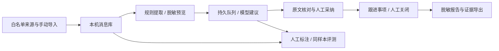

# 交付跟进助手：案例事实与演示稿

本材料是待真实试用补充的初稿，不是已取得岗位收益的申报结论。

| 事实等级 | 可陈述内容 | 当前证据 |
| --- | --- | --- |
| 已实现、离线验证 | 项目绑定、导入、规则与事项、人工复核、持久队列、版本冲突、报告及评测导出、留存清理、分发启动 | 源码、自动测试、构造页面操作、干净目录 smoke |
| 模拟验证 | AI 提取/进展建议的完整操作链路和指标统计 | 明确标记 mock 的接口和三条构造标注；不代表 DeepSeek 效果 |
| 待实测 | 30–50 项独立标注、20 批延迟、参与者使用耗时与收益 | 尚无独立质量与收益记录，不能填写达标率或节省工时 |
| 本机用户试用 | 用户已保存模型配置并完成一批分析，产生 7 条待复核建议 | 本机已有成功任务；本轮界面改版保留该结果，未新增云端调用；不能据此推断识别质量 |
| 本机实测 | Mac 4.1.13（269629）指定群历史、新消息、@昵称与重启去重 | 私有本机验证记录；99 条首次历史，收到编号新消息和 @昵称消息；不是其他设备兼容性或模型质量结论 |
| 待环境验证 | Windows 目标构建取钥/解码、其他 Mac 设备兼容性 | 仍需独立门禁和真机验证 |

岗位问题：交付群消息分散，任务、问题、决策和风险容易混在一起；人工整理需回看原文，确认后的进展仍需持续跟踪。工具把消息、识别建议、人工确认和报告依据串在同一项目中，自动化辅助整理，责任认定和业务完成由人决定。

三分钟构造演示：先说明数据与接口均为构造；按“微信与群聊 → 采集规则 → 开始采集”保存群名和规则，展示导入预览；在“AI 分析”查看原文并建立事项；在临时模拟界面预览、入队、采纳建议，保持“待确认结果”；人工改进度并查看版本；在“信息与报告”生成报告，指出未分析范围和失败计数；展示评测分子分母及“尚未满足真实试用条件”；下载脱敏 CSV。

真实试用记录待补：参与者代号、授权来源及时间区间、独立标注 ID 与判定依据、开发/验收集划分、实际模型 ID/请求元信息、误报/漏报/字段错误、单批耗时和重试、人工规则秒数、AI 等待+复核+导出秒数、熟悉样本偏差、修改前后结论。取得记录前不填数字、不制作成果提升图，不自动发送申报材料。

## 0.5.6 自动采集到结果

新增按整理空间一次开启的自动整理模式，后续消息自动脱敏分析并写入结果，无需逐批预览或采纳。自动结果不冒充人工确认，不自动关闭业务；人工修改受保护，冲突留为建议。已采集历史和已有建议不自动处理。新增测试使用构造消息与模拟模型，不能推导真实模型精准度或实际节省工时。

## 0.5.7 界面收敛

移除“更多”、效果评测和旧规则汇总的用户界面；保留事项跟进报告。按 taste-design 校准五步导航、标题与说明文字、按钮尺寸、卡片阴影、手机单列和运行状态动效。本轮只调整静态界面，不代用户处理事项或新增模型请求。
